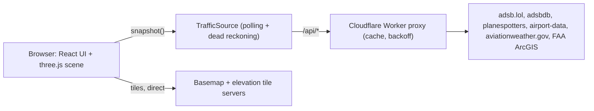

# SkyWatch

A live 3D flight tracker. Pick any airport and watch the surrounding traffic move over real terrain, with runways, lights, airspace and weather, all rendered in the browser with three.js.

**Live demo:** https://flight-tracker.scottgrunerud98.workers.dev

This project was built entirely by AI coding agents (Claude Code) orchestrating subagents.

## Features

- Live 3D traffic around any airport, smoothly interpolated between feed updates
- Terrain from elevation tiles, with a tile level-of-detail (LOD) map
- Runway markings and runway/approach lights, plus runways of nearby airports
- Controlled airspace volumes (US only, off by default)
- 3D NEXRAD weather radar volume (US, WEATHER menu, off by default), decoded in the browser
- METAR weather line for the selected airport
- Aircraft photos, type, operator and registration; airline logos
- Light and dark themes
- Filters, a TRAFFIC list and an ARRIVALS tab (flights whose looked-up route ends at the airport)
- Follow camera and per-flight track history

## How it works



- **Worker proxy.** `worker/` serves `/api/*` (states, aircraft, photo, route, track, metar, airspace), caches responses, and backs off on 429/5xx. Everything else is static assets (SPA).
- **TrafficSource.** `src/data/` polls `/api/states` and exposes `snapshot(now)`. Between polls, aircraft are dead-reckoned from ground speed, track and vertical rate, and eased toward each new report, so motion stays smooth.
- **Scene scale.** `src/scene/` uses 1 world unit = 1 km, centered on the airport. Altitude and terrain relief share an adjustable vertical exaggeration so low-level traffic is readable.
- **Tile LOD rings.** A detailed ring of map tiles surrounds the airport and a cheaper, lower-zoom ring lies beneath it for far coverage.
- **Terrain.** Elevation tiles (Terrarium PNG, or Mapbox Terrain-RGB) are decoded into meshes draped with the basemap.
- **Per-frame work stays out of React.** The scene animates from `TrafficSource.snapshot()` directly; React only refreshes panels at about 2 Hz.
- **Arrivals.** An aircraft is listed as an arrival only when its real route destination (adsbdb) matches the airport's IATA or ICAO code. There is no distance-based guessing and no ETA.

## Data sources

| Source                                                                                       | Used for                                                                                | License / terms                               | Key                             |
| -------------------------------------------------------------------------------------------- | --------------------------------------------------------------------------------------- | --------------------------------------------- | ------------------------------- |
| [adsb.lol](https://adsb.lol)                                                                 | Live traffic (point API) and flight traces                                              | ODbL 1.0                                      | No                              |
| [adsbdb](https://www.adsbdb.com)                                                             | Aircraft details (type, owner) and callsign routes                                      | Free public API                               | No                              |
| [planespotters.net](https://www.planespotters.net)                                           | Aircraft photo fallback                                                                 | Photos credited to photographers, linked back | No                              |
| [airport-data.com](https://www.airport-data.com)                                             | Aircraft photos (URLs via adsbdb)                                                       | Site terms; credited in UI                    | No                              |
| [OurAirports](https://ourairports.com/data/)                                                 | Airports and runways (baked by `bake:airports`)                                         | Public domain                                 | No                              |
| [aviationweather.gov](https://aviationweather.gov) (FAA/NWS)                                 | METAR                                                                                   | US government, public                         | No                              |
| FAA Class_Airspace (ArcGIS FeatureServer)                                                    | US Class B/C/D airspace                                                                 | Public domain                                 | No                              |
| [NOAA NEXRAD Level II](https://registry.opendata.aws/noaa-nexrad/) via Unidata/AWS Open Data | 3D weather radar (fetched by the browser from `unidata-nexrad-level2.s3.amazonaws.com`) | Public domain (NOAA)                          | No                              |
| [AWS Terrain Tiles](https://registry.opendata.aws/terrain-tiles/) (Terrarium)                | Elevation (default)                                                                     | Open data; see AWS registry for attributions  | No                              |
| [Mapbox](https://www.mapbox.com)                                                             | Optional basemap and optional Terrain-RGB elevation                                     | Mapbox terms, attribution shown               | Optional (`VITE_MAPBOX_TOKEN`)  |
| Esri World Dark/Light Gray Canvas                                                            | Keyless fallback basemap                                                                | Esri terms, attribution shown                 | No                              |
| [OpenSky Network](https://opensky-network.org)                                               | Optional alternate traffic source, local dev only (blocks Cloudflare)                   | OpenSky terms                                 | Optional (client id and secret) |
| [tar1090-db](https://github.com/wiedehopf/tar1090-db)                                        | Aircraft type database, baked by `bake:aircraft`                                        | See upstream                                  | No                              |
| [Jxck-S/airline-logos](https://github.com/Jxck-S/airline-logos)                              | Airline logos, baked by `bake:logos`                                                    | Trademarks of their owners                    | No                              |
| [Flightradar24 3D models](https://github.com/Flightradar24/fr24-3d-models)                   | Aircraft models, baked by `bake:models`                                                 | GPL-2.0                                       | No                              |

## Running locally

```sh
pnpm i
pnpm dev
```

Everything works with no configuration. Optional settings:

- `.env.local` (see `.env.example`): `VITE_MAPBOX_TOKEN`, `VITE_MAPBOX_STYLE`, `VITE_MAPBOX_STYLE_LIGHT`, `VITE_TERRAIN_SOURCE`
- `.dev.vars` (see `.dev.vars.example`): `TRAFFIC_SOURCE` (`adsblol` or `opensky`), `OPENSKY_CLIENT_ID`, `OPENSKY_CLIENT_SECRET`

Data bake scripts (some outputs are gitignored; the app degrades gracefully without them):

| Command              | Produces                                             |
| -------------------- | ---------------------------------------------------- |
| `pnpm bake:airports` | `public/data/airports.json` from OurAirports         |
| `pnpm bake:aircraft` | aircraft type database from tar1090-db               |
| `pnpm bake:logos`    | airline logos in `public/logos/`                     |
| `pnpm bake:models`   | optimized aircraft `.glb` models in `public/models/` |

## Testing

```sh
pnpm verify   # typecheck, lint, unit tests, build
pnpm e2e      # Playwright end-to-end tests
```

Unit tests never touch the network.

## Deploying

```sh
pnpm deploy   # runs pnpm verify, then wrangler deploy to Cloudflare Workers
```

## AI crawlers

`public/robots.txt` disallows known AI crawlers, and the worker (which runs first for every request, see `assets.run_worker_first` in `wrangler.jsonc`) returns 403 to matching User-Agents on pages and `/api/*`. The list lives in `worker/aiBots.ts`. This is best effort: it relies on bots identifying themselves.

## License and third-party notices

Project code is MIT licensed; see [LICENSE](LICENSE).

- **Aircraft models** in `public/models` are derived from the [Flightradar24 3D models](https://github.com/Flightradar24/fr24-3d-models), licensed under GPL-2.0 (see `public/models/LICENSE`). That license applies to those files, not the project code.
- **Baked, gitignored data** is downloaded by the scripts above and is not redistributed in this repository: the aircraft type database (from [tar1090-db](https://github.com/wiedehopf/tar1090-db)) and airline logos (from [Jxck-S/airline-logos](https://github.com/Jxck-S/airline-logos); logos are trademarks of their respective owners).
- Live data and imagery belong to the providers listed under Data sources; follow their terms.
